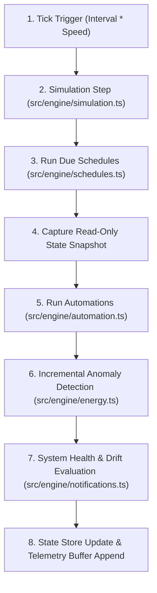
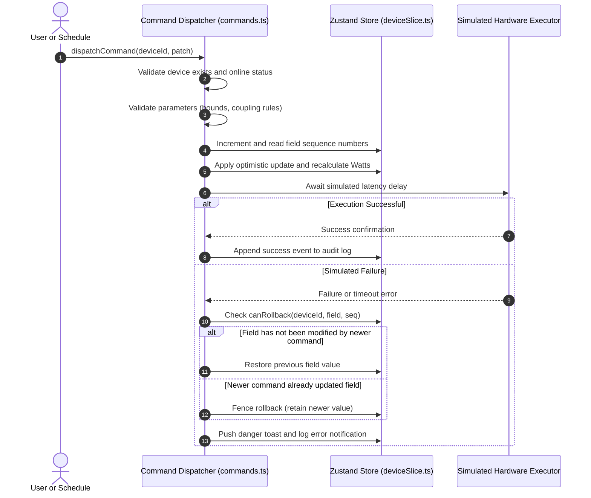
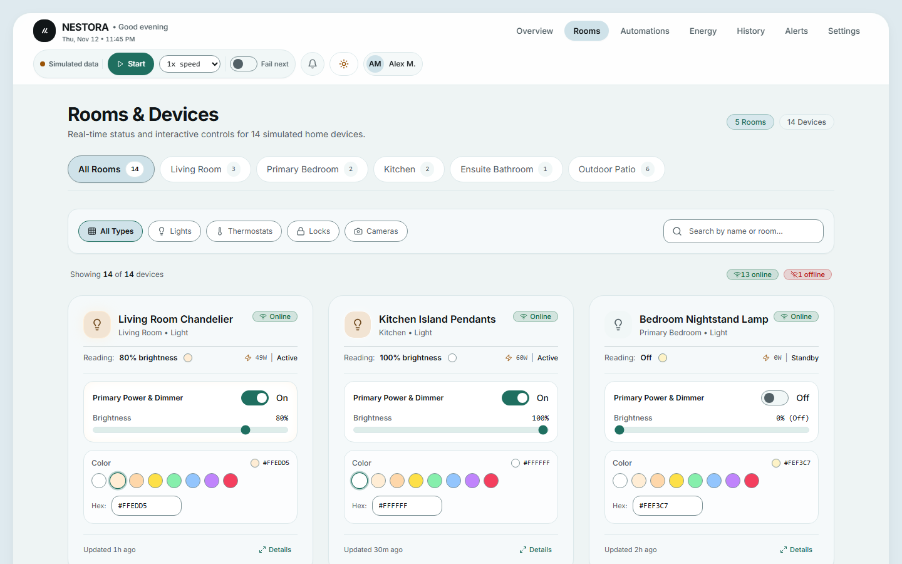
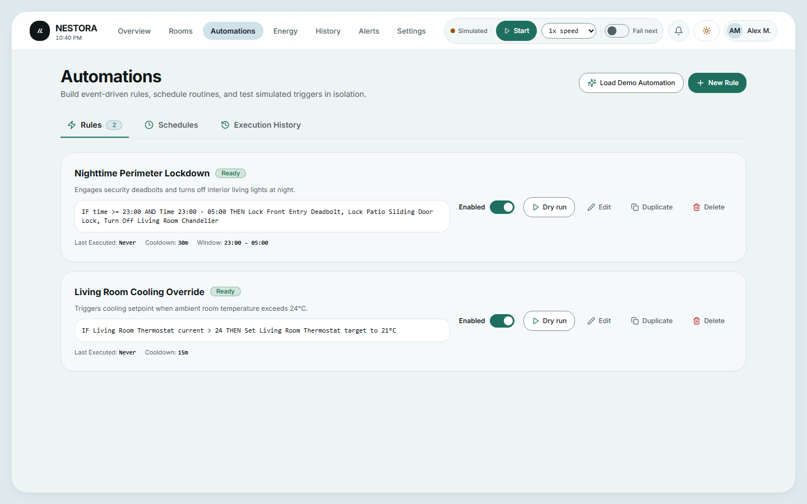

# Homie SmartSpace

Homie SmartSpace is a client-side simulated smart home and IoT control dashboard built with React, TypeScript, Tailwind CSS, and Zustand.

Live deployment: [https://homie-smartspace.vercel.app](https://homie-smartspace.vercel.app)

---

## Table of Contents

- [Overview](#overview)
- [Problem Statement and Acceptance Criteria](#problem-statement-and-acceptance-criteria)
- [Features by Area](#features-by-area)
- [Tech Stack](#tech-stack)
- [Getting Started](#getting-started)
- [Project Structure](#project-structure)
- [Architecture](#architecture)
- [How It Works](#how-it-works)
- [Testing](#testing)
- [Performance](#performance)
- [Accessibility](#accessibility)
- [Screenshots](#screenshots)
- [Known Limitations](#known-limitations)
- [Demo Video](#demo-video)
- [Project Status](#project-status)

---

## Overview

Homie SmartSpace provides a user interface for monitoring and configuring simulated connected devices across multiple rooms in a home. The application is designed for evaluators, frontend engineers, and product reviewers who want to inspect a complex state-driven single-page application.

All device state, telemetry, sensor readings, and energy numbers are simulated in the browser. The project requires no physical smart devices, no network gateways, no MQTT broker, and no backend service or external API keys. All state is maintained locally in memory and synchronized to browser local storage.

---

## Problem Statement and Acceptance Criteria

Smart home dashboards must handle concurrent device updates, fluctuating telemetry streams, energy calculations, automation rule evaluation, and historical logging without depending on live physical hardware during development or demonstration. Homie SmartSpace addresses this by providing a deterministic simulation runtime alongside real-time user controls, failure injection, and state recovery mechanisms.

The following table maps the twelve core requirements to their implementation in the code and the verification method used.

| Requirement | Where in the app | How it is verified |
| :--- | :--- | :--- |
| Room device grid with online and offline states | Rooms & Devices (`/rooms`), Overview (`/`) | `tests/unit/roomsDevices.test.tsx` |
| Simulated real-time telemetry through a mock event stream | Overview (`/`), simulation runtime hook | `tests/unit/simulation.test.ts`, `tests/unit/runtime.test.ts` |
| Custom controls (radial dial, color picker, dimmer, schedule editor) | Rooms & Devices (`/rooms`), Automations (`/automations`) | `tests/unit/controls.test.tsx`, `tests/unit/automationsUI.test.tsx` |
| Optimistic updates with rollback on mock failure | Device cards (`/rooms`), Command dispatcher | `tests/unit/commands.test.ts` |
| Energy analytics (live and historical charts, range selector, breakdowns) | Energy Analytics (`/energy`), Overview (`/`) | `tests/unit/energy.test.ts`, `tests/unit/overviewEnergy.test.tsx` |
| Anomaly highlighting on charts | Energy Analytics charts (`/energy`) | `tests/unit/energy.test.ts`, `tests/unit/overviewEnergy.test.tsx` |
| Automation builder with multiple conditions and time windows | Automations (`/automations`) Rule Builder modal | `tests/unit/automation.test.ts`, `tests/unit/automationsUI.test.tsx` |
| Dry-run simulator | Automations (`/automations`) Dry-Run modal | `tests/unit/dryRun.test.ts`, `tests/unit/automationsUI.test.tsx` |
| Toast and notification center | App header drawer, Notifications (`/notifications`) | `tests/unit/notifications.test.ts`, `tests/unit/notificationsPage.test.tsx` |
| Filterable virtualized event log at 10,000+ rows | Event History (`/history`) | `tests/unit/eventFilters.test.ts`, `tests/unit/eventHistoryPage.test.tsx` |
| Responsive layout with dark and light mode | Global AppShell layout (`375px`, `768px`, `1440px`) | `tests/unit/responsive.test.tsx`, `tests/unit/theme.test.tsx` |
| GitHub repo and demo video | Repository link and walkthrough documentation | manual check (video link marked below) |

---

## Features by Area

### Overview

The Overview page (`/`) presents the high-level operational status of the simulated home. It displays the primary room stage with ambient temperature and humidity readings, a quick-control lock card, and quick controls for lighting and climate. The right panel contains a semi-circular arc gauge displaying brightness or thermostat target, surrounded by pastel metric tiles for power, energy, indoor temperature, and humidity. Below the fold, the page provides summary metric strips, a seven-day energy consumption bar chart, a device status breakdown chart, and a quick device list.

### Rooms and Devices

The Rooms and Devices page (`/rooms`) organizes devices by room and category. Users can filter by individual rooms, filter by device type, or search by device name and room name. Supported device types are lights, thermostats, smart locks, and security cameras. Each device card displays connectivity status, power draw in Watts, and context-sensitive controls. Offline devices display an explanatory badge and disable active control inputs.

### Automations and Schedules

The Automations page (`/automations`) is divided into three functional tabs:
- Rules: displays configured automation rules written in structured sentence form. Each rule can be enabled, disabled, duplicated, edited, or deleted.
- Schedules: separates configured time schedules from past executed runs. Configured schedules display their computed next execution time.
- History: an audit log of executed, skipped, and failed automation runs with detailed evaluation reasons.

### Energy Analytics

The Energy Analytics page (`/energy`) provides power and energy analysis across five timeframes: 1 hour, 24 hours, 7 days, 30 days, and custom date ranges. It renders an instantaneous power chart (Watts) and a cumulative energy chart (kilowatt-hours). Statistical anomalies are plotted directly on the power chart with distinct triangle markers. The page includes summary cards, per-device consumption breakdown bars, per-room consumption breakdown bars, and an accessible table data alternative.

### Event History

The Event History page (`/history`) displays an audit log containing 10,000 seeded events. Rows are virtualized to limit DOM element creation. A sticky filter toolbar provides text search, event type filtering, severity filtering, room filtering, and timestamp sorting. Clicking any event row opens a modal inspector displaying raw event properties and structured metadata with a copy-to-clipboard action.

### Notifications

The Notifications page (`/notifications`) and the header drawer display system alerts categorized into device events, security alerts, energy surges, system lifecycle events, and automations. Notifications are grouped by relative time periods (Today, Yesterday, Older). Users can mark individual notifications as read, mark all as read, or dismiss them. Critical events also trigger temporary toast notifications in the application shell.

### Settings

The Settings page (`/settings`) allows configuration of client-side appearance and simulation parameters. Users can select Light, Dark, or System theme modes. The simulation controls section allows adjusting clock speed (1x, 2x, 5x, 10x), changing the PRNG seed, setting failure probability, arming the fail-next-command debug switch, and forcing room temperature or humidity overrides. It also provides JSON configuration export, JSON configuration import with schema validation, and a modal to reset all state to factory demo defaults.

---

## Tech Stack

| Technology | Version | Purpose |
| :--- | :--- | :--- |
| React | 18.3.1 | Component-based user interface rendering |
| React DOM | 18.3.1 | Browser DOM rendering for React |
| React Router DOM | 6.28.0 | Client-side routing and location management |
| TypeScript | 5.6.3 | Static type checking with strict compiler options |
| Vite | 5.4.11 | Build tool and local development server |
| Tailwind CSS | 3.4.15 | Utility-first styling with design system tokens |
| Zustand | 5.0.1 | Global state management with slice architecture |
| Recharts | 2.13.3 | SVG chart rendering for power and energy analytics |
| @tanstack/react-virtual | 3.10.9 | Row virtualization for 10,000+ item event log |
| Lucide React | 0.460.0 | Icon library for navigation, status, and controls |
| Vitest | 2.1.4 | Unit and integration test runner |
| @testing-library/react | 16.0.1 | React component DOM testing utilities |
| JSDOM | 25.0.1 | Headless browser DOM environment for Node.js tests |
| ESLint | 8.57.1 | Static code analysis and linting rules |
| PostCSS | 8.4.49 | CSS transformation pipeline for Tailwind CSS |
| Autoprefixer | 10.4.20 | Vendor prefixing for compiled stylesheets |

---

## Getting Started

### Prerequisites

- Node.js version 20.18.0 or higher (Node 20 or 22 LTS recommended)
- npm version 10.8.2 or higher

### Installation

Clone the repository and install dependencies:

```powershell
git clone https://github.com/shalinireddy67/Homie-SmartSpace.git
cd Homie-SmartSpace
npm install
```

### Development Server

Start the local development server:

```powershell
npm run dev
```

The application will be available at `http://localhost:5173`.

### Production Build and Preview

Build the production bundle and preview it locally:

```powershell
npm run build
npm run dev -- --port 5188
```

### Typecheck and Lint

Run static type checking and ESLint:

```powershell
npm run typecheck
npm run lint
```

### Automated Tests

Run the full test suite:

```powershell
npm test
```

### Available Scripts

The following scripts are defined in `package.json`:

| Script | Command | Purpose |
| :--- | :--- | :--- |
| `dev` | `vite` | Starts local development server with hot module replacement |
| `build` | `tsc && vite build` | Typechecks code and compiles production bundle to `dist/` |
| `typecheck` | `tsc --noEmit` | Runs TypeScript compiler checks without emitting files |
| `lint` | `eslint . --ext ts,tsx --report-unused-disable-directives --max-warnings 0` | Validates code style and syntax rules |
| `test` | `vitest run` | Executes all unit and integration test files |

---

## Project Structure

```
├── docs/
│   ├── screenshots/
│   │   └── after-v2/
│   ├── DESIGN.md
│   └── SPEC.md
├── public/
│   ├── fonts/
│   │   └── inter-variable.woff2
│   └── favicon.svg
├── scripts/
│   ├── capture-overview-screenshots.mjs
│   ├── capture-screenshots.mjs
│   ├── verify-all-pages.mjs
│   ├── verify-browser-automations.mjs
│   └── verify-browser.mjs
├── src/
│   ├── components/
│   │   ├── automations/
│   │   ├── common/
│   │   ├── controls/
│   │   ├── devices/
│   │   ├── layout/
│   │   ├── notifications/
│   │   └── overview/
│   ├── constants/
│   │   ├── branding.ts
│   │   └── navigation.ts
│   ├── engine/
│   │   ├── automation.ts
│   │   ├── commands.ts
│   │   ├── dryRun.ts
│   │   ├── energy.ts
│   │   ├── eventFilters.ts
│   │   ├── index.ts
│   │   ├── interfaces.ts
│   │   ├── notifications.ts
│   │   ├── runtime.ts
│   │   ├── schedules.ts
│   │   └── simulation.ts
│   ├── hooks/
│   │   ├── useChartTheme.ts
│   │   ├── useDocumentTitle.ts
│   │   ├── useRuntime.ts
│   │   ├── useTheme.ts
│   │   └── useThrottledLiveTelemetry.ts
│   ├── pages/
│   │   ├── AutomationsPage.tsx
│   │   ├── EnergyAnalyticsPage.tsx
│   │   ├── EventHistoryPage.tsx
│   │   ├── NotFoundPage.tsx
│   │   ├── NotificationsPage.tsx
│   │   ├── OverviewPage.tsx
│   │   ├── RoomsDevicesPage.tsx
│   │   └── SettingsPage.tsx
│   ├── services/
│   │   └── commandDispatcher.ts
│   ├── store/
│   │   ├── selectors/
│   │   ├── slices/
│   │   ├── storage/
│   │   └── index.ts
│   ├── types/
│   │   ├── automation.ts
│   │   ├── device.ts
│   │   ├── energy.ts
│   │   ├── event.ts
│   │   ├── index.ts
│   │   ├── notification.ts
│   │   └── simulation.ts
│   ├── utils/
│   │   ├── formatters.ts
│   │   ├── prng.ts
│   │   └── seedData.ts
│   ├── App.tsx
│   ├── index.css
│   └── main.tsx
├── tests/
│   ├── unit/
│   └── setup.ts
├── DEMO.md
├── PROJECT_STATUS.md
├── index.html
├── package.json
├── package-lock.json
├── tailwind.config.ts
├── tsconfig.json
└── vite.config.ts
```

### Folder Purpose

- `docs/`: Technical specification documents, design system definitions, and visual screenshot records.
- `public/`: Static web assets, variable typography fonts, and application favicon.
- `scripts/`: Headless browser verification, performance profiling, and screenshot capture tools.
- `src/`: Application source code, including React components, simulation engine, pages, store, and utilities.
- `tests/`: Automated unit and integration test suites executed by Vitest.

---

## Architecture

The system decouples user presentation from the simulation engine. UI components read from the Zustand state store and dispatch commands through an asynchronous command dispatcher. The background simulation runtime periodically ticks the physical simulation models, evaluates scheduled tasks, checks automation rules, runs statistical anomaly detection, and generates system telemetry.

### Runtime Step Order

The runtime tick is coordinated by `src/engine/runtime.ts` and proceeds in the following sequential order:



### Command Lifecycle

User-initiated commands and schedule actions pass through `src/engine/commands.ts`, enforcing validation, optimistic application, and per-field rollback fencing:



---

## How It Works

### Simulation Engine

The simulation engine is implemented in `src/engine/simulation.ts`. It models ambient temperature fluctuations using a diurnal cosine curve with customizable amplitude, minimum, and peak hour settings. Room temperatures update each tick according to Newton's law of cooling, exchanging heat with outside ambient air and active heating or cooling appliances. The engine also simulates ambient light level drift based on time of day and introduces pseudo-random noise through a deterministic Mulberry32 PRNG. Speed adjustments (1x to 10x) scale the delta time passed to each physical simulation step without skipping intermediate physics steps.

### Commands, Optimistic Updates and Per-Field Rollback

Command handling is implemented in `src/engine/commands.ts`. When a user toggles a switch or changes a setpoint, the dispatcher validates that the target device exists, is online, and that parameter constraints are met (such as thermostat temperature bounds). The patch is immediately written to the Zustand store, recomputing the device's electrical power draw in Watts on the same tick. A monotonic integer sequence counter is incremented per modified field. If execution fails, the rollback logic checks whether the field's current sequence number matches the failed command's sequence number. If a newer command has already modified the field, the rollback is fenced off, preserving the newer state.

### Automation Rules

The automation rule engine is implemented in `src/engine/automation.ts`. Rules contain multiple conditions joined by either AND or OR boolean operators, optional time windows, and active weekday filters. Rules evaluate strictly against an immutable state snapshot with edge-triggered semantics: a rule fires only when transitioning from false to true. Once fired, rules respect a configurable cooldown period in minutes before becoming eligible to trigger again. Actions dispatched by automations carry a `causedByAutomation: true` flag, preventing cascading loops where automated actions re-trigger other rules. Conflicting actions targeting the same field in a single evaluation cycle are resolved in favor of the last rule in evaluation order, while actions targeting offline devices are skipped without crashing.

### Dry-Run Simulator

The dry-run simulator is implemented in `src/engine/dryRun.ts`. It provides an isolated sandbox to evaluate automation rules against hypothetical or current device readings without altering live state. The dry-run engine invokes the exact same pure evaluation logic used by the live runtime (`evaluateRule`). It produces a structured audit report detailing individual condition outcomes, group operator results, time window matches, and proposed action statuses. The dry-run process dispatches no store updates, schedules no commands, and emits no notification records.

### Schedules

The scheduling subsystem is implemented in `src/engine/schedules.ts`. The schedule runner separates schedule configurations (`Schedule`) from execution history records (`ScheduleExecution`). The `computeNextRun` function calculates the upcoming execution timestamp relative to current time using local date components to handle daylight saving transitions. If a schedule is disabled, it returns null. The runner enforces single-fire execution for each due timestamp, preventing duplicate runs. When the runtime is resumed after a pause, a catch-up guard executes the schedule at most once and marks older missed runs as skipped.

### Anomaly Detection

Statistical anomaly detection is implemented in `src/engine/energy.ts` within the `detectAnomalies` function. The algorithm uses a rolling Gaussian baseline calculating the mean and standard deviation over the preceding historical window (default 24 points). The current point being evaluated is excluded from its own baseline calculation. To prevent false positives on flat telemetry, the standard deviation is clamped to a minimum floor (10.0 W for power, 0.5 °C for temperature, 1.0 % for humidity). Points with fewer than a minimum sample count (default 8 points) are never flagged. A data point is identified as an anomaly when its value exceeds the threshold:

$$\text{Threshold} = \text{Mean} + k \times \max(\text{Standard Deviation}, \text{Floor})$$

where $k$ defaults to 3.

### Energy Units

Energy metrics are calculated in `src/engine/energy.ts`. Instantaneous power is measured in Watts (W), representing the current rate of electricity consumption. Total energy is measured in kilowatt-hours (kWh), representing the integral of power consumption over time. The energy contribution for a time bucket is calculated as:

$$\text{Bucket Energy (kWh)} = \frac{\text{Average Watts} \times \text{Bucket Hours}}{1000}$$

Bucket durations vary by selected timeframe: 1 hour uses 60 one-minute buckets; 24 hours uses 24 one-hour buckets; 7 days uses 7 one-day buckets; 30 days uses 30 one-day buckets. Per-device and per-room breakdowns are integrated using the exact same formulas, ensuring that the sum of component kWh values equals the aggregate total kWh.

### Event Log Virtualization and Filtering

Event querying and display are implemented in `src/engine/eventFilters.ts` and `src/pages/EventHistoryPage.tsx`. The initial state contains 10,000 deterministic seeded events. To allow responsive searching, the engine precomputes a lowercase compound string (`_searchField`) combining the description, resolved device name, and event type. Multi-facet filters combine text search, event type, severity, room, and timestamp boundaries using logical AND operations. The UI uses `@tanstack/react-virtual` to virtualize the list, rendering only the rows currently visible within the scrolling container viewport.

### Persistence

Client persistence is implemented in `src/store/storage/persistence.ts`. Only user configuration (custom devices, rules, schedules, notification preferences, simulation settings, and theme) is written to local storage under the key `HOMIE_SMARTSPACE_V1_STATE`. The 10,000 seeded audit events and high-frequency live telemetry buffers are regenerated deterministically on reload from the PRNG seed, maintaining a compact storage footprint under 10 KB. State writes are debounced by 500 ms and flushed immediately on page navigation or reload. When an older schema key from prior versions is detected, the loader validates the payload, saves it under the new keys, and deletes the old keys without throwing errors.

---

## Testing

The automated test suite is run with Vitest:

```powershell
npm test
```

### Test Suite Summary

- Test Files: 26 passed (26 total)
- Tests: 254 passed (254 total, 0 failed, 0 skipped)

### Test File Scope

| Test File | Verified Area |
| :--- | :--- |
| `tests/unit/automation.test.ts` | Pure rule evaluation, edge-triggering, cooldowns, and loop guards |
| `tests/unit/automationsUI.test.tsx` | Rule builder modal, dynamic rows, validation errors, and tab switches |
| `tests/unit/commands.test.ts` | Command dispatching, optimistic updates, and rollback fencing |
| `tests/unit/controls.test.tsx` | Dimmer sliders, color pickers, and radial dial interaction |
| `tests/unit/dryRun.test.ts` | Dry-run isolation, deep-freeze immutability, and zero side-effects |
| `tests/unit/energy.test.ts` | Anomaly detection, standard deviation floors, and energy aggregation |
| `tests/unit/eventFilters.test.ts` | Precomputed index, multi-facet filtering, and sorting benchmarks |
| `tests/unit/eventHistoryPage.test.tsx` | Virtualized row rendering, filter toolbar, and event details modal |
| `tests/unit/modal.test.tsx` | Modal dialog rendering, focus trapping, and keyboard escape handling |
| `tests/unit/navigation.test.tsx` | React Router page switching, sidebar, header, and active links |
| `tests/unit/notFoundPage.test.tsx` | 404 page rendering, layout, and return navigation button |
| `tests/unit/notifications.test.ts` | Alert deduplication, category cooldowns, and toast generation |
| `tests/unit/notificationsPage.test.tsx` | Notifications list, time grouping, unread counters, and mark read |
| `tests/unit/overviewEnergy.test.tsx` | Metric cards, simulation warning banners, and chart range selector |
| `tests/unit/persistence.test.ts` | LocalStorage round-trip, corruption handling, and legacy key migration |
| `tests/unit/prng.test.ts` | Mulberry32 PRNG determinism and distribution reproducibility |
| `tests/unit/responsive.test.tsx` | Responsive landmarks, skip link, and mobile navigation layout |
| `tests/unit/roomsDevices.test.tsx` | Device card rendering, room filtering, search, and rollback toasts |
| `tests/unit/runtime.test.ts` | Runtime tick ordering, scheduled jobs, and telemetry streaming |
| `tests/unit/schedules.test.ts` | Next run calculations, recurrence rules, DST handling, and dispatch |
| `tests/unit/seedData.test.ts` | Deterministic seed generator, device models, and 10,000 initial events |
| `tests/unit/selectors.test.ts` | Zustand memoized selectors for device counts and energy totals |
| `tests/unit/settingsPage.test.tsx` | Theme mode selector, simulation overrides, and JSON export/import |
| `tests/unit/simulation.test.ts` | Diurnal thermal models, Newton's law of cooling, and sensor noise |
| `tests/unit/store.test.ts` | Root Zustand store initialization and device state updates |
| `tests/unit/theme.test.tsx` | Theme hook, DOM class toggling, and legacy theme key migration |

---

## Performance

The following benchmarks were measured by running unit test suites and the build pipeline:

| Measurement | Measured Value | Method |
| :--- | :--- | :--- |
| Precomputed search index (10,000 events) | 64.93 ms | Benchmark test in `tests/unit/eventFilters.test.ts` |
| Filter 10,000 events to 455 matching items | 18.92 ms | Benchmark test in `tests/unit/eventFilters.test.ts` |
| Sort 10,000 events by timestamp | 7.75 ms | Benchmark test in `tests/unit/eventFilters.test.ts` |
| 1,000 full runtime simulation steps | 167.48 ms (0.167 ms/step) | Benchmark test in `tests/unit/runtime.test.ts` |
| Production application JS bundle size | 297.80 kB (70.11 kB gzip) | Vite production build output (`dist/assets/index-*.js`) |
| Production vendor JS bundle size | 648.61 kB (182.26 kB gzip) | Vite production build output (split vendor chunks) |
| Production CSS bundle size | 50.93 kB (9.02 kB gzip) | Vite production build output (`dist/assets/index-*.css`) |
| LocalStorage persisted state payload | ~9.34 KB | Measured JSON string length of user configuration |

Note: No browser frame-rate measurement was performed in this task. Virtualization benchmarks reflect Node.js V8 execution times.

---

## Accessibility

The application implements the following accessibility patterns:

- Semantic Landmarks: Pages use `<header>`, `<main>`, `<nav>`, and `<aside>` container landmarks.
- Skip Link: A skip-to-content link is present as the first focusable element on every page.
- Keyboard Navigation: All buttons, form elements, sliders, and interactive cards provide visible focus rings (`focus-ring`).
- Dialog Accessibility: Modals and drawers use `role="dialog"`, declare `aria-modal="true"`, provide explicit `aria-label` or `aria-labelledby` attributes, and handle the Escape key.
- Minimum Touch Targets: Interactive controls on mobile viewports are sized to at least 44 by 44 pixels.
- Live Regions: The notification badge and live status updates use `aria-live="polite"`.
- Table Data Alternative: The Energy Analytics page provides a toggleable tabular view of chart data with table headers and row data.

---

## Screenshots

The following screenshots are captured from the production build at 1440 pixel desktop width in light mode:

### Overview Dashboard

*Figure 1: Overview page showing room stage, quick controls, arc gauge, and telemetry summary.*

### Rooms and Devices

*Figure 2: Multi-room device cards with category filters, dimmer sliders, and status indicators.*

### Automations and Rule Builder

*Figure 3: Structured automation rules list, cooldown badges, and execution status.*

### Energy Analytics and Anomaly Markers

*Figure 4: Power and energy consumption charts with highlighted statistical anomaly markers.*

### Virtualized Event History

*Figure 5: High-density virtualized event audit log with multi-facet filter bar.*

### Notifications Center

*Figure 6: System notification list grouped by time periods with severity chips.*

### Settings and Simulation Controls

*Figure 7: Theme mode selection, simulation parameter overrides, and JSON export tools.*

---

## Known Limitations

The following features and integrations are intentionally omitted from this project:

- No Real Hardware Integration: The project does not interface with Matter, Zigbee, Z-Wave, Home Assistant, or physical IoT devices.
- No Backend or Database: There is no server process, REST API, WebSocket server, or persistent external database.
- Unbuilt Device Classes: Air purifiers, smart speakers, humidifiers, EV chargers, and smart appliances are not built.
- Unbuilt Sensor Telemetry: Exterior weather feeds, air quality index (AQI), and solar photovoltaic generation are not modeled.
- No Global Search: Search bars operate within their specific page domain (rooms/devices or event log).
- Client Memory Boundaries: High-frequency live telemetry buffers are maintained in browser memory and reset on reload.

---

## Demo Video

Walkthrough video: To be added.

A detailed scripted walkthrough and timestamp guide is documented in [DEMO.md](DEMO.md).

---

## Project Status

Homie SmartSpace has completed its core functional requirements and design specification. All seven primary views and the 404 handler are implemented and pass unit, integration, and type verification. The application operates entirely within the browser client using mock simulation models, providing a testable environment for exploring smart home dashboard workflows.

---

## 🔍 Search and Sharing

Homie SmartSpace is a client-rendered single-page application (SPA). As a client-rendered SPA, search engine ranking is not claimed. The application includes baseline metadata and crawl assets for standard sharing and indexing:

- **Metadata**: Standard Open Graph (`og:*`), Twitter Cards (`summary_large_image`), and valid JSON-LD (`WebApplication`) structured data configured in `index.html`.
- **Per-Route Metadata**: The `useRouteSeo` hook synchronizes `document.title`, description, canonical link, and Open Graph URL on route transitions. Unknown routes dynamically apply a `noindex, nofollow` directive.
- **Crawl Configuration**: `public/robots.txt` points to `public/sitemap.xml`, which lists the 7 canonical route URLs (`https://homie-smartspace.vercel.app/`).
- **Deep Linking**: `vercel.json` provides single-page application route rewrites so direct navigation to subpaths (e.g., `/energy`, `/history`) resolves to `index.html` while preserving 404 responses on missing static assets.

---

## 📄 License
MIT License. Created for the Advanced Frontend Cohort Evaluation.
