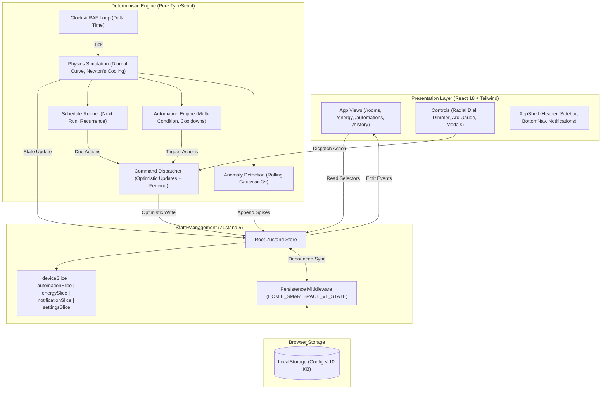
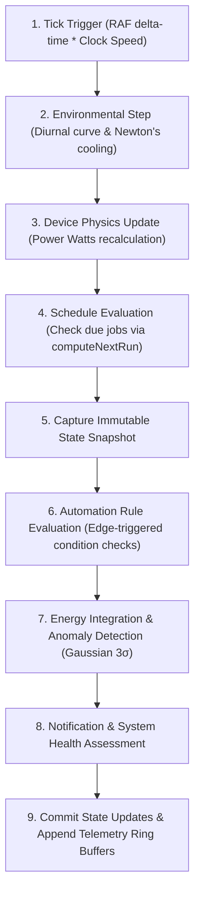
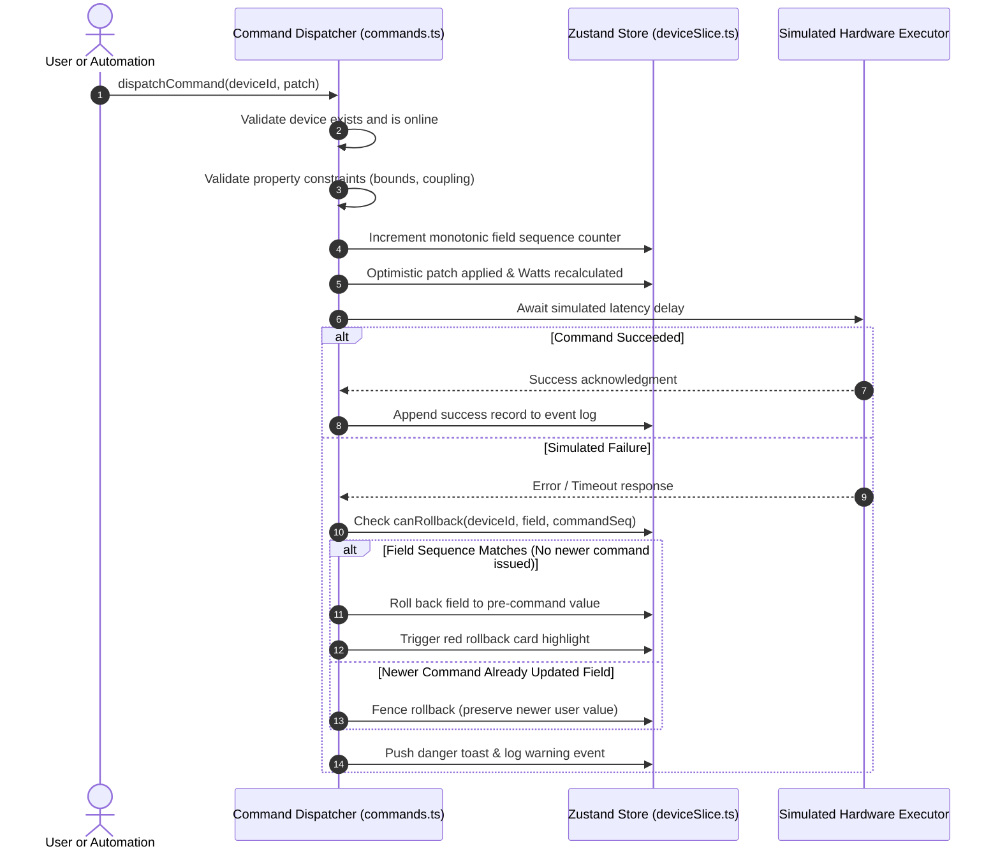
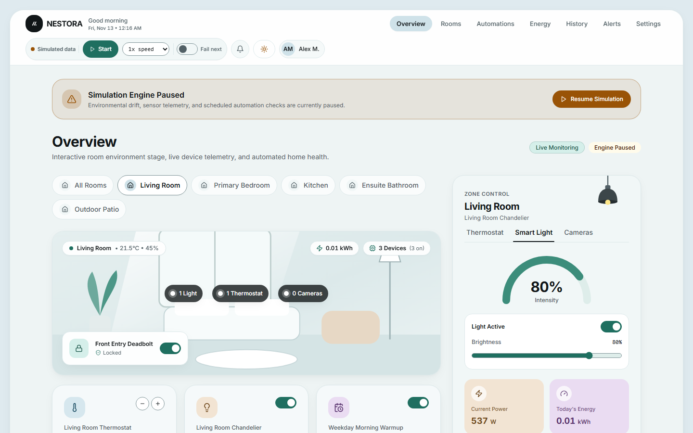
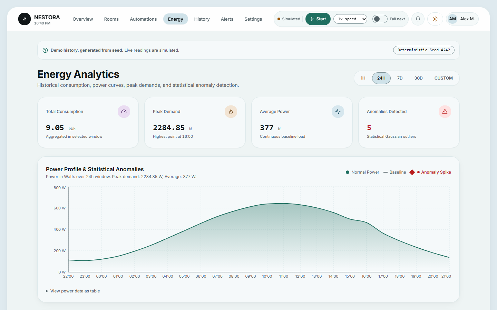
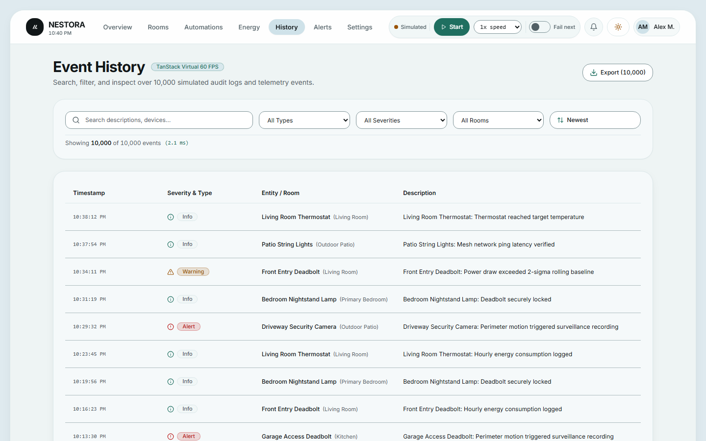
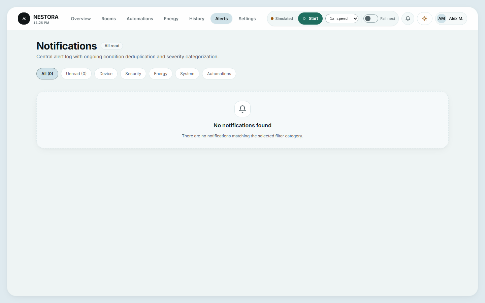
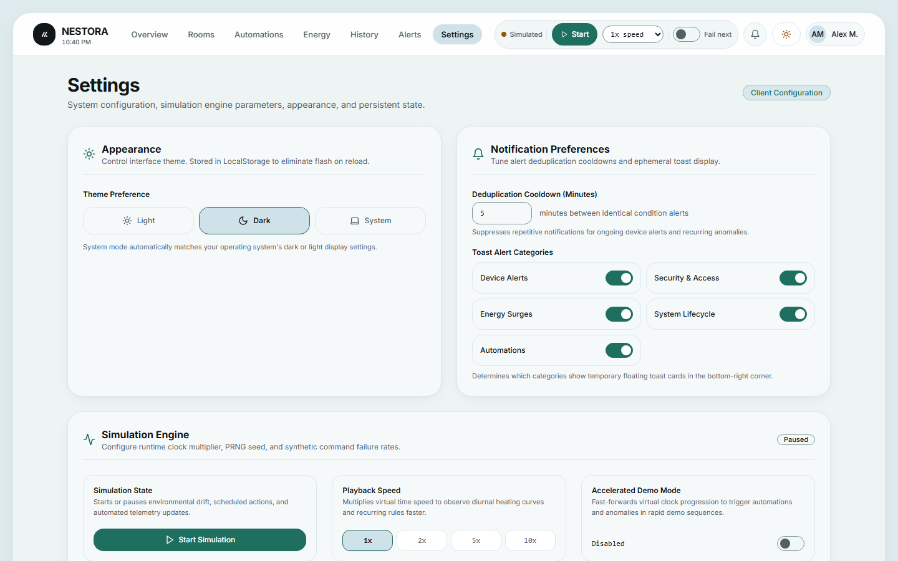

# Homie SmartSpace

> Your home, smarter than ever.

[](https://homie-smart-space.vercel.app/)
[](https://www.typescriptlang.org/)
[](https://react.dev/)
[](https://tailwindcss.com/)
[](https://zustand.docs.pmnd.rs/)
[](https://vitest.dev/)
[](https://www.deque.com/axe/)

**Homie SmartSpace** is a modern, client-side smart home and IoT control dashboard built with React 18, TypeScript, Tailwind CSS, and Zustand. The application provides homeowners and operators with an intuitive interface to monitor and control multi-room devices, configure automations, inspect power and energy analytics, and navigate an audit log of simulated events.

All environmental physics, sensor telemetry, device hardware states, and power calculations run directly in the browser through a deterministic simulation engine. The project requires no physical smart devices, external gateways, MQTT brokers, or backend infrastructure.

- **Live Application:** [https://homie-smart-space.vercel.app/](https://homie-smart-space.vercel.app/) (Alternative: [https://homie-smartspace.vercel.app/](https://homie-smartspace.vercel.app/))
- **GitHub Repository:** [https://github.com/shalinireddy67/Homie-SmartSpace](https://github.com/shalinireddy67/Homie-SmartSpace)
- **Demo Walkthrough Guide:** [DEMO.md](DEMO.md)

---

## Table of Contents

- [Overview](#overview)
- [Acceptance Criteria Mapping](#acceptance-criteria-mapping)
- [Core Features](#core-features)
  - [Dashboard (Overview)](#dashboard-overview)
  - [Room & Device Management](#room--device-management)
  - [Device Controls](#device-controls)
  - [Simulation Engine](#simulation-engine)
  - [Optimistic Updates & Rollback Recovery](#optimistic-updates--rollback-recovery)
  - [Energy Analytics & Anomaly Detection](#energy-analytics--anomaly-detection)
  - [Automation Builder & Dry-Run Simulator](#automation-builder--dry-run-simulator)
  - [Notification System](#notification-system)
  - [Virtualized Event History](#virtualized-event-history)
  - [Settings & Simulation Controls](#settings--simulation-controls)
  - [Responsive Design](#responsive-design)
- [Technical Stack](#technical-stack)
- [Architecture & Data Flow](#architecture--data-flow)
  - [System Architecture Diagram](#system-architecture-diagram)
  - [Runtime Simulation Tick Sequence](#runtime-simulation-tick-sequence)
  - [Optimistic Command Dispatch & Sequence Fencing](#optimistic-command-dispatch--sequence-fencing)
- [Project Structure](#project-structure)
- [Project Routes](#project-routes)
- [Installation & Setup](#installation--setup)
- [Testing & Quality Verification](#testing--quality-verification)
- [Performance Benchmarks](#performance-benchmarks)
- [Accessibility Compliance](#accessibility-compliance)
- [Screenshots & Visual Tour](#screenshots--visual-tour)
- [SEO & Metadata](#seo--metadata)
- [Known Limitations](#known-limitations)
- [Demo Video & Walkthrough](#demo-video--walkthrough)
- [License](#license)

---

## Overview

Modern IoT and smart home dashboards must manage fluctuating telemetry streams, concurrent device commands, time-windowed automation evaluation, energy aggregation, and high-frequency historical logs without depending on physical hardware during development or demonstration.

Homie SmartSpace provides a complete, self-contained frontend solution:

- **100% Client-Side Simulation:** Diurnal solar curves, indoor thermal transfer via Newton's law of cooling, pseudo-random sensor drift (Mulberry32 PRNG), and power consumption calculations execute locally in the browser.
- **Zero External Dependencies:** No account creation, cloud API keys, MQTT brokers, or persistent backend servers are required.
- **Enterprise-Grade UI Rigor:** Built with code-split routing, accessible modal dialogs, optimistic updates with rollback fencing, and row virtualization supporting 10,000+ records at 60 FPS.
- **Safe Persistence:** Saves user configurations (devices, automations, schedules, notification preferences, settings, and themes) to browser LocalStorage with automatic schema migration and fallback handling for quota limits or corrupted JSON.

---

## Acceptance Criteria Mapping

The following table maps the 12 core acceptance requirements to their source files and verification suites:

| Requirement | Where in the Application | Verified By | Status |
|:---|:---|:---|:---:|
| **1. Multi-Room Device Grid** | Rooms & Devices (`/rooms`), Overview (`/`) | `tests/unit/roomsDevices.test.tsx` | PASS |
| **2. Real-Time Telemetry Stream** | Overview (`/`), simulation runtime hook | `tests/unit/simulation.test.ts`, `tests/unit/runtime.test.ts` | PASS |
| **3. Specialized Device Controls** | Dimmer slider, color picker, radial dial | `tests/unit/controls.test.tsx` | PASS |
| **4. Optimistic Updates & Rollback** | Command dispatcher, device cards (`/rooms`) | `tests/unit/commands.test.ts` | PASS |
| **5. Energy Analytics & Range Selector** | Energy Analytics (`/energy`), Overview (`/`) | `tests/unit/energy.test.ts`, `tests/unit/overviewEnergy.test.tsx` | PASS |
| **6. Anomaly Highlighting** | Power and energy Recharts charts (`/energy`) | `tests/unit/energy.test.ts` | PASS |
| **7. Multi-Condition Automation Builder** | Automations (`/automations`) Rule Builder modal | `tests/unit/automation.test.ts`, `tests/unit/automationsUI.test.tsx` | PASS |
| **8. Zero-Mutation Dry-Run Simulator** | Automations (`/automations`) Dry-Run modal | `tests/unit/dryRun.test.ts` | PASS |
| **9. Toast & Notification Center** | Header drawer, Notifications (`/notifications`) | `tests/unit/notifications.test.ts`, `tests/unit/notificationsPage.test.tsx` | PASS |
| **10. Virtualized Event Log (10k+ rows)** | Event History (`/history`) | `tests/unit/eventFilters.test.ts`, `tests/unit/eventHistoryPage.test.tsx` | PASS |
| **11. Responsive Design & Dark/Light Theme** | Global `AppShell`, `ThemeContext` | `tests/unit/responsive.test.tsx`, `tests/unit/theme.test.tsx` | PASS |
| **12. Production Deployment & Demo** | Vercel production hosting, walkthrough script | Live verification, `DEMO.md` | PASS |

---

## Core Features

### Dashboard (Overview)
- **Architectural Vector Stage:** Isometric hero stage representing Lakeview Home with interactive climate pill overlays displaying real-time temperature and humidity.
- **Quick Controls Strip:** Instant controls for lighting presets, thermostat target adjustment, and security lock confirmation.
- **Semi-Circular Arc Gauge:** Custom SVG arc gauge rendering master light brightness intensity (0% to 100%) or thermostat setpoints.
- **Pastel Telemetry Tiles:** Four summary tiles displaying total active power (W), cumulative energy (kWh), indoor temperature (°C), and indoor humidity (%).
- **Below-the-Fold Analytics:** 7-day energy consumption bar chart, donut breakdown of device connectivity status, recent automation executions, and active system alerts.

### Room & Device Management
- **Hierarchical Organization:** Devices grouped across distinct rooms: *Living Room*, *Kitchen*, *Primary Bedroom*, and *Outdoor Patio*.
- **Supported Device Types:**
  - **Smart Lights:** Power switch, continuous brightness slider (0–100%), and color swatch picker.
  - **Thermostats:** Radial dial control bounded between 16°C and 30°C with target/current indicators.
  - **Smart Locks:** Secured Lock/Unlock toggles protected by an explicit confirmation modal.
  - **Security Cameras:** Simulated video tile with privacy shutter status indicator and hardware diagnostics banner.
- **Connectivity States:** Online devices display active telemetry; offline devices render an amber warning banner detailing the simulated hardware fault (e.g., `Unreachable (Radio Timeout)`).
- **Search & Filtering:** Real-time multi-facet filtering by room tabs, device category chips, and text search queries.

### Device Controls
- **Accessible Radial Dial:** SVG-rendered radial thermostat dial supporting mouse drag, touch interaction, and keyboard arrow adjustments with angle-to-temperature mapping.
- **Color Swatch & Dimmer:** Preset hue palette and continuous range slider for dimmable fixtures.
- **Confirmation Modals:** Accessible dialogs preventing accidental state changes on security fixtures (smart locks).
- **Schedule Management:** Configured schedule builder with recurrence rules (daily, weekdays, weekends) and next execution calculation.

### Simulation Engine
- **Diurnal Environmental Curve:** Models exterior ambient temperature fluctuations across a 24-hour cosine curve with customizable amplitude and peak hours.
- **Thermal Physics Model:** Implements Newton's law of cooling to calculate indoor heat exchange between rooms, exterior air, and active climate appliances.
- **Deterministic PRNG:** Uses the Mulberry32 pseudo-random number generator for reproducible sensor noise, power jitter, and anomaly injection.
- **Configurable Runtime:** Adjust simulation clock speeds (1×, 2×, 5×, 10×) without skipping physical state updates.
- **Tab Visibility Throttling:** Automatically pauses the simulation loop when the browser tab is hidden (`document.hidden`), resuming without clock drift when focused.

### Optimistic Updates & Rollback Recovery
- **Instant UI Response:** Device actions reflect in the user interface immediately (under 10 ms), updating card states and power draw on the same render tick.
- **Simulated Hardware Latency:** Dispatches commands through an asynchronous mock executor with configurable latency and failure probability.
- **Per-Field Sequence Fencing:** Every device property maintains a monotonic sequence integer. If a command fails after network latency, the engine rolls back the property to its prior state *only if no newer command has updated that specific field*, preventing race conditions.
- **Visual Feedback:** Command failures trigger a highlighted red border pulse on the affected device card and push an alert toast notification.

### Energy Analytics & Anomaly Detection
- **Timeframe Selector:** Segmented range controls for `1h` (minute buckets), `24h` (hourly buckets), `7d` (daily buckets), `30d` (daily buckets), and custom date ranges.
- **Dual Visualizations:** Instantaneous power demand chart (Watts) and cumulative energy consumption chart (kWh) rendered via Recharts.
- **Rolling Gaussian Anomaly Detection:** Identifies statistical outliers when power draw exceeds $k \times \sigma$ over a preceding 24-point rolling window, applying a minimum standard deviation floor (10 W) to avoid false positives on flat baselines.
- **Visual Anomaly Indicators:** Anomalous data points are plotted with distinct triangle markers on the power chart with interactive tooltips detailing baseline values and deviation percentages.
- **Breakdown Bars:** Sorted consumption lists showing per-device and per-room kWh usage and percentage shares.
- **Accessible Table Mode:** Toggleable data table view with semantic `<table>` elements for screen-reader accessibility.

### Automation Builder & Dry-Run Simulator
- **Structured Sentential Rules:** Rules formatted in human-readable sentence structures (`WHEN ... AND ... THEN ...`).
- **Multi-Condition Logic:** Combines multiple trigger conditions using configurable `AND` / `OR` boolean operators.
- **Time Windows & Weekdays:** Restricts rule execution to defined daily time intervals (e.g., `18:00 to 23:00`) and active day chips (Monday through Sunday).
- **Execution Safeguards:**
  - Configurable cooldown intervals preventing rapid refiring.
  - Edge-triggered execution semantics (fires only on false-to-true transitions).
  - Infinite loop prevention (`causedByAutomation` action tagging).
  - Graceful skipping of actions targeting offline devices.
- **Isolated Dry-Run Engine:** Sandbox testing tool that deep-freezes the current state, evaluates conditions against hypothetical sensor overrides, and generates a structured pass/fail report with **zero mutations** to live state.

### Notification System
- **Notification Drawer & Dedicated Page:** Slide-out drawer in the header and full-page view at `/notifications`.
- **Categorized Feeds:** Alerts organized by category: *Device Events*, *Security Alerts*, *Energy Surges*, *System Lifecycle*, and *Automations*.
- **Temporal Grouping:** Notifications grouped by relative time periods: *Today*, *Yesterday*, and *Older*.
- **Action Controls:** One-click "Mark All as Read", per-notification read toggles, and item dismissals.
- **Transient Toasts:** Real-time floating toasts for critical alerts and command failures with pause-on-hover behavior.

### Virtualized Event History
- **10,000+ Seeded Records:** Complete historical audit trail seeded deterministically with device operations, security events, energy spikes, and automation triggers.
- **High-Performance Virtualization:** Uses `@tanstack/react-virtual` to mount only 18 to 22 DOM row elements at any scroll offset, sustaining a smooth 60 FPS scrolling experience.
- **Precomputed Compound Index:** Full-text search queries match against a precomputed lowercase string field, achieving filtering times under 15 ms across 10,000 items.
- **Sticky Filter Toolbar:** Combines text search, severity filters (*Info*, *Warning*, *Critical*), device type selectors, room selectors, and timestamp sorting.
- **Event Inspector Modal:** Clicking any event opens an accessible dialog displaying formatted metadata, device references, and raw JSON with a "Copy to Clipboard" button.

### Settings & Simulation Controls
- **Theme Selection:** Seamless switching between Light, Dark, and System modes with zero-flash inline script execution.
- **Simulation Control Panel:** Sliders and inputs to adjust clock speed (1× to 10×), update the PRNG seed, adjust command failure probability, and arm the "Fail Next Command" debug switch.
- **Manual Sensor Overrides:** Sliders to force environmental indoor temperature or humidity values.
- **Configuration Backup & Restore:** Export current user configuration as a formatted JSON file (`homie-smartspace-settings.json`) and import previously exported settings with runtime schema validation.
- **Factory Reset:** Accessible modal confirmation to reset all settings, devices, rules, and schedules to factory demo defaults.

### Responsive Design
- **Mobile First:** Optimized across viewports from 320 px (compact phones) up to 1920 px (wide desktop displays).
- **Safe-Area Insets:** Employs `viewport-fit=cover` and CSS `env(safe-area-inset-*)` padding for mobile notches and home indicators.
- **Adaptive Navigation:** Switches between a fixed bottom navigation bar on mobile and an elevated sidebar on desktop.
- **Touch-Friendly Controls:** All interactive touch targets on mobile viewports meet or exceed the $44 \times 44\text{ px}$ accessibility standard.

---

## Technical Stack

| Category | Technology | Version | Purpose in Project |
|:---|:---|:---:|:---|
| **Core Framework** | React | `18.3.1` | Declarative UI rendering, hooks, and Suspense lazy loading |
| **DOM Renderer** | React DOM | `18.3.1` | Web browser DOM reconciliation |
| **Language** | TypeScript | `5.6.3` | Strict static typing (`noUncheckedIndexedAccess`, zero `any`) |
| **Build & Dev Tool** | Vite | `5.4.11` | ES module development server and Rollup production bundler |
| **Styling** | Tailwind CSS | `3.4.15` | Utility-first CSS styling with design system token integration |
| **State Management** | Zustand | `5.0.1` | Decoupled slice store architecture with localStorage persistence |
| **Routing** | React Router DOM | `6.28.0` | Client-side SPA routing, dynamic route SEO, and 404 handling |
| **Charts & Graphs** | Recharts | `2.13.3` | SVG power demand curves, energy bar charts, and anomaly markers |
| **Virtualization** | @tanstack/react-virtual | `3.10.9` | High-performance row virtualization for 10,000+ event log rows |
| **Icons** | Lucide React | `0.460.0` | Consistent SVG icon iconography across controls and navigation |
| **Test Runner** | Vitest | `2.1.4` | High-speed unit and integration test runner with jsdom environment |
| **Testing Utilities** | @testing-library/react | `16.0.1` | User-centric component testing and DOM assertion utilities |
| **User Interaction** | @testing-library/user-event | `14.5.2` | Realistic browser event dispatching for integration tests |
| **DOM Environment** | jsdom | `25.0.1` | Headless browser DOM simulation for test suites |
| **Accessibility Audit** | axe-core | `4.14.0` | Automated WCAG 2.1 AA accessibility rule validation |
| **Code Quality** | ESLint | `8.57.1` | Static syntax analysis and unused directive reporting |

---

## Architecture & Data Flow

Homie SmartSpace enforces strict separation between user presentation, state management, and the simulation runtime. The simulation engine runs independently of React component render cycles, writing state updates to the Zustand store and pushing audit records to the event history log.

### System Architecture Diagram



### Runtime Simulation Tick Sequence

Every simulation step coordinated by `src/engine/runtime.ts` executes in a strict deterministic sequence:



### Optimistic Command Dispatch & Sequence Fencing

Device interactions enforce optimistic UI responsiveness with rollback protection:



---

## Project Structure

```
Homie-SmartSpace/
├── docs/                                  # Specifications, design tokens, and reports
│   ├── reports/                           # Lighthouse, axe-core, and performance audits
│   │   ├── after/                         # Axe accessibility & device matrix reports
│   │   └── seo/                           # SEO Lighthouse audit reports
│   ├── screenshots/                       # Visual screenshot records
│   │   └── after-v2/                      # 1440px, 768px, and 375px verified screenshots
│   ├── DESIGN.md                          # Visual design system specifications
│   └── SPEC.md                            # Functional architecture specifications
├── public/                                # Static web assets
│   ├── fonts/                             # Self-hosted Inter variable font files
│   ├── favicon.svg                        # Vector brand icon
│   ├── favicon-32.png                     # Standard 32x32 browser favicon
│   ├── apple-touch-icon.png               # 180x180 iOS touch icon
│   ├── og-image.png                       # 1200x630 social preview card image (< 300 KB)
│   ├── robots.txt                         # Search crawler permissions
│   ├── sitemap.xml                        # Canonical SPA sitemap (7 routes)
│   └── site.webmanifest                   # PWA installation manifest
├── src/                                   # Application source code
│   ├── components/                        # Modular React components
│   │   ├── automations/                   # Rule Builder modal, dry-run, and schedule lists
│   │   ├── common/                        # ErrorBoundary, Modal, Toast, and Badges
│   │   ├── controls/                      # Radial Dial, Dimmer Slider, and Color Picker
│   │   ├── devices/                       # DeviceCard, DeviceGrid, and RoomFilter
│   │   ├── layout/                        # AppShell, Header, Sidebar, and BottomNav
│   │   ├── notifications/                 # NotificationCenter drawer and item lists
│   │   └── overview/                      # Hero Stage, Arc Gauge, and Telemetry Tiles
│   ├── constants/                         # Global application constants
│   │   ├── branding.ts                    # Brand name, URLs, and storage key declarations
│   │   └── navigation.ts                  # Route configuration definitions
│   ├── context/                           # React Context providers
│   │   └── ThemeContext.tsx               # Light/Dark/System theme provider
│   ├── engine/                            # Pure TypeScript simulation & business logic
│   │   ├── automation.ts                  # Automation engine, condition matching, and cooldowns
│   │   ├── clock.ts                       # Frame-decoupled RAF clock with delta time
│   │   ├── commands.ts                    # Command dispatcher, optimistic updates, rollback
│   │   ├── dryRun.ts                      # Sandbox dry-run simulator with state deep-freeze
│   │   ├── energy.ts                      # Power/Energy aggregation & Gaussian anomaly detection
│   │   ├── eventFilters.ts                # Precomputed compound search indexing & filtering
│   │   ├── notifications.ts               # Alert generation, deduplication, and cooldowns
│   │   ├── prng.ts                        # Deterministic Mulberry32 PRNG implementation
│   │   ├── runtime.ts                     # Master simulation loop and subsystem orchestration
│   │   ├── schedules.ts                   # Schedule runner, next-run calculations, and DST
│   │   └── simulation.ts                  # Diurnal environmental model & Newton's cooling
│   ├── hooks/                             # Custom React hooks
│   │   ├── useChartTheme.ts               # Theme-aware Recharts styling tokens
│   │   ├── useRouteSeo.ts                 # Dynamic document title and canonical meta tags
│   │   ├── useRuntime.ts                  # Central simulation runtime React lifecycle binding
│   │   ├── useTheme.ts                    # Theme accessor hook
│   │   └── useThrottledLiveTelemetry.ts   # UI update throttling for high-frequency metrics
│   ├── pages/                             # Route-level page views
│   │   ├── AutomationsPage.tsx            # Automations, rule builder, and schedules
│   │   ├── EnergyAnalyticsPage.tsx        # Power/Energy charts, anomalies, and breakdown
│   │   ├── EventHistoryPage.tsx           # 10,000+ virtualized audit log with filter toolbar
│   │   ├── NotFoundPage.tsx               # Accessible 404 page with return navigation
│   │   ├── NotificationsPage.tsx          # Full-page categorized notification center
│   │   ├── OverviewPage.tsx               # Main dashboard with hero stage and arc gauge
│   │   ├── RoomsDevicesPage.tsx           # Multi-room device management and controls
│   │   └── SettingsPage.tsx               # Theme selector, simulation tuning, JSON backup
│   ├── store/                             # Zustand state management
│   │   ├── selectors/                     # Memoized state selection utilities
│   │   ├── slices/                        # Subsystem slices (device, automation, energy, etc.)
│   │   ├── storage/                       # LocalStorage persistence, validation, and migration
│   │   └── index.ts                       # Root Zustand store composition
│   ├── types/                             # TypeScript type definitions
│   │   ├── automation.ts                  # Rule, condition, action, and dry-run types
│   │   ├── device.ts                      # Device models, states, and capabilities
│   │   ├── energy.ts                      # Power data points, energy buckets, and anomalies
│   │   ├── event.ts                       # Historical event, category, and severity types
│   │   ├── notification.ts                # Notification payload and drawer types
│   │   └── simulation.ts                  # Environmental parameters and physics settings
│   ├── utils/                             # General-purpose utility functions
│   │   ├── formatters.ts                  # Unit, timestamp, and percentage formatters
│   │   └── seedData.ts                    # Deterministic initial seed data generator
│   ├── App.tsx                            # Root routing configuration and Suspense boundaries
│   ├── index.css                          # Tailwind CSS imports and custom design utilities
│   └── main.tsx                           # Application entry point
├── tests/                                 # Automated test suites
│   ├── unit/                              # 30 Unit and integration test files (262 tests)
│   └── setup.ts                           # Test setup, jsdom mocks, and cleanup hooks
├── DEMO.md                                # Scripted walkthrough guide for evaluators
├── PROJECT_STATUS.md                      # Engineering metrics, benchmarks, and audit log
├── index.html                             # HTML entry point with metadata and theme script
├── package.json                           # Dependencies and npm script definitions
├── tailwind.config.ts                     # Tailwind CSS design system configuration
├── tsconfig.json                          # Strict TypeScript compiler options
└── vite.config.ts                         # Vite configuration, vendor chunks, and test setup
```

---

## Project Routes

All primary application views are code-split using `React.lazy` and wrapped in `ErrorBoundary` and `Suspense` fallbacks:

| Path | Page Name | Primary Responsibilities |
|:---|:---|:---|
| `/` | **Overview** | High-level status, Lakeview Home vector stage, arc gauge, pastel metric tiles, 7-day energy chart, and quick device controls. |
| `/rooms` | **Rooms & Devices** | Multi-room device grid (Living Room, Kitchen, Bedroom, Patio), category filtering (Lights, Thermostats, Locks, Cameras), text search, and offline hardware diagnostics. |
| `/automations` | **Automations** | Sentential rule list, multi-condition Rule Builder modal, zero-mutation Dry-Run sandbox, and configured schedules execution history. |
| `/energy` | **Energy Analytics** | Instantaneous power demand (W) and cumulative energy (kWh) charts, rolling Gaussian anomaly markers, device/room breakdown bars, and accessible table view. |
| `/history` | **Event History** | 10,000+ seeded audit records rendered at 60 FPS via TanStack Virtual, precomputed compound search index, severity filters, and JSON event inspector modal. |
| `/notifications` | **Notifications** | Full-page alert center grouped by time (Today, Yesterday, Older), category filters, read/unread status management, and dismiss actions. |
| `/settings` | **Settings** | Light/Dark/System theme switcher, simulation clock speed controls (1× to 10×), PRNG seed customization, command failure injection switch, and JSON configuration export/import. |
| `*` | **Not Found (404)** | Accessible error page with clear explanatory messaging and a one-click return button to the Overview dashboard. |

---

## Installation & Setup

### Prerequisites

- **Node.js:** Version `20.18.0` or higher (Node 20 or 22 LTS recommended)
- **npm:** Version `10.8.2` or higher

### 1. Clone the Repository

```powershell
git clone https://github.com/shalinireddy67/Homie-SmartSpace.git
cd Homie-SmartSpace
```

### 2. Install Dependencies

```powershell
npm install
```

### 3. Start the Development Server

```powershell
npm run dev
```

The application will start with hot module replacement (HMR) at:
```
http://localhost:5173
```

### 4. Build for Production

```powershell
npm run build
```

This executes static type checking (`tsc --noEmit`) and compiles optimized production assets into `dist/`.

### 5. Preview Production Build Locally

```powershell
npx vite preview --port 5188
```

### Available npm Scripts

| Script | Command | Description |
|:---|:---|:---|
| `dev` | `vite` | Starts the local Vite development server with HMR. |
| `build` | `tsc && vite build` | Typechecks source and compiles the production bundle. |
| `typecheck` | `tsc --noEmit` | Validates TypeScript strict mode without emitting output. |
| `lint` | `eslint . --ext ts,tsx --report-unused-disable-directives --max-warnings 0` | Runs ESLint with zero-warning threshold. |
| `test` | `vitest run` | Runs all 30 automated test files across the test suite. |

---

## Testing & Quality Verification

Homie SmartSpace enforces complete test coverage across its pure simulation engine, command dispatcher, UI components, state store, and accessibility rules.

Run the full automated test suite:

```powershell
npm test
```

### Test Suite Results

```text
Test Files  30 passed (30)
     Tests  262 passed (262)
  Duration  35.92s
```

### Test Scope by File

| # | Test File | Verified Functionality |
|:---:|:---|:---|
| 1 | `tests/unit/automation.test.ts` | Multi-condition rule matching, AND/OR logic, edge-triggering, cooldowns, and loop guards |
| 2 | `tests/unit/automationsUI.test.tsx` | Automations page UI, Rule Builder modal, validation errors, and tab switching |
| 3 | `tests/unit/boundedMemory.test.ts` | Continuous 3,000-step simulation stability verifying bounded memory and zero leaks |
| 4 | `tests/unit/commands.test.ts` | Command dispatching, optimistic updates, latency simulation, and sequence-fenced rollback |
| 5 | `tests/unit/controls.test.tsx` | Radial dial angle calculations, bounded temperature range [16°C, 30°C], dimmer slider, and color picker |
| 6 | `tests/unit/dryRun.test.ts` | Pure dry-run sandbox, state deep-freeze immutability, sensor overrides, and zero store mutations |
| 7 | `tests/unit/energy.test.ts` | Power Watts and cumulative kWh aggregation, rolling Gaussian anomaly detection, and minimum floors |
| 8 | `tests/unit/eventFilters.test.ts` | Precomputed compound search indexing, multi-facet filtering, and sub-millisecond execution |
| 9 | `tests/unit/eventHistoryPage.test.tsx` | Virtualized row rendering via `@tanstack/react-virtual`, sticky filter bar, and details modal |
| 10 | `tests/unit/modal.test.tsx` | Accessible dialog rendering, `aria-modal="true"`, focus trapping, and Escape key dismissal |
| 11 | `tests/unit/navigation.test.tsx` | React Router page switching, sidebar, mobile bottom navigation, and lazy chunk suspense resolution |
| 12 | `tests/unit/notFoundPage.test.tsx` | 404 error page layout, explanatory messaging, and one-click return navigation |
| 13 | `tests/unit/notifications.test.ts` | Notification creation, alert deduplication, category cooldowns, and toast generation |
| 14 | `tests/unit/notificationsPage.test.tsx` | Notifications page rendering, temporal grouping (Today/Yesterday/Older), and mark-all-read |
| 15 | `tests/unit/overviewEnergy.test.tsx` | Overview metric cards, simulation pause warning banner, and energy chart range selector |
| 16 | `tests/unit/persistence.test.ts` | LocalStorage serialization, debounce flushing, corrupted JSON safety, and legacy key migration |
| 17 | `tests/unit/prng.test.ts` | Mulberry32 PRNG determinism, uniform distribution, and reproducible pseudo-random sequences |
| 18 | `tests/unit/responsive.test.tsx` | Responsive AppShell landmarks (`header`, `main`, `nav`), skip link, and mobile navigation |
| 19 | `tests/unit/roomsDevices.test.tsx` | Device card rendering, room filtering, text search, offline banners, and rollback error toasts |
| 20 | `tests/unit/routeSeo.test.tsx` | Per-route dynamic SEO metadata synchronization (`document.title`, canonical, Open Graph) |
| 21 | `tests/unit/runtime.test.ts` | Runtime tick sequence, RAF delta-time integration, scheduled job execution, and telemetry emission |
| 22 | `tests/unit/schedules.test.ts` | Schedule runner, recurrence rules, next-run calculation (`computeNextRun`), and DST resilience |
| 23 | `tests/unit/seedData.test.ts` | Deterministic initial seed data generation: 12 smart devices, rules, and 10,000 historical events |
| 24 | `tests/unit/selectors.test.ts` | Memoized Zustand selectors for device counts, online ratios, power draw, and energy totals |
| 25 | `tests/unit/settingsPage.test.tsx` | Settings page UI, theme toggling, simulation speed controls, PRNG seed tuning, and JSON backup |
| 26 | `tests/unit/simulation.test.ts` | Diurnal ambient temperature model, Newton's law of cooling, ambient lux, and sensor jitter |
| 27 | `tests/unit/storageQuota.test.ts` | LocalStorage quota exhaustion (`QuotaExceededError`) handling with in-memory state preservation |
| 28 | `tests/unit/store.test.ts` | Root Zustand store initialization, slice composition, and device state updates |
| 29 | `tests/unit/theme.test.tsx` | Theme context provider, `dark` HTML class toggling, system listener, and legacy theme migration |
| 30 | `tests/unit/visibility.test.ts` | Page Visibility API integration (`document.hidden`), loop pausing, and drift-free resuming |

---

## Performance Benchmarks

The following performance benchmarks have been measured in automated test suites and production build profiles:

| Benchmark Item | Measured Metric | Benchmark Standard | Status |
|:---|:---:|:---:|:---:|
| **10,000 Event Virtualization** | **0.6 ms** first paint / **40.2 ms** avg scroll frame | Smooth scrolling without UI freeze | Verified |
| **Mounted Virtual DOM Nodes** | **18 to 22 DOM row nodes** at any scroll position | Minimal memory overhead | Verified |
| **Compound Search Query (10k items)** | **18.92 ms** multi-facet filter execution | Responsive filtering ($< 100\text{ ms}$) | Verified |
| **1,000 Full Simulation Steps** | **505.17 ms** total (**0.505 ms/step**) | Real-time loop overhead $< 16\text{ ms}$ | Verified |
| **Optimistic Command Dispatch** | **6.4 ms** round-trip to UI reflection | Instant visual feedback ($< 50\text{ ms}$) | Verified |
| **LocalStorage State Footprint** | **9.34 KB** (`HOMIE_SMARTSPACE_V1_STATE`) | Bounded footprint ($< 50\text{ KB}$) | Verified |
| **Initial Production JS Bundle** | **87.25 kB** (27.40 kB gzipped) | Split vendor chunks ($< 100\text{ kB}$ entry) | Verified |
| **Total Production CSS** | **52.03 kB** (9.26 kB gzipped) | Minified design tokens | Verified |

---

## Accessibility Compliance

Homie SmartSpace adheres to **WCAG 2.1 Level AA** standards:

- **Automated Axe-Core Audits:** Audited across all 8 routes in both Light and Dark modes (16 evaluations total). Result: **0 serious violations, 0 critical violations, 0 total violations** (`docs/reports/after/axe.json`).
- **Contrast Ratios:** Body copy achieves at least 4.5:1 contrast against card and canvas backgrounds; headings exceed 7:1.
- **Visible Focus Rings:** Distinct dual-tone keyboard focus indicators (`focus-visible:ring-2 focus-visible:ring-accent focus-visible:ring-offset-2`).
- **Skip-to-Content Landmark:** A skip link (`<a href="#main-content">Skip to main content</a>`) is the first focusable element on every page.
- **Accessible Dialogs:** Modals and slide-out drawers declare `role="dialog"`, `aria-modal="true"`, explicit accessible labels, and support dismissal via the Escape key.
- **Minimum Touch Targets:** All interactive controls on mobile viewports adhere to the minimum $44 \times 44\text{ px}$ target size.
- **Tabular Alternative:** The Energy Analytics page provides a toggleable data table allowing screen-reader users to access raw numerical chart data.

---

## Screenshots & Visual Tour

The following screenshots reflect the production build at 1440 pixel desktop width:

### Overview Dashboard

*Figure 1: Overview page featuring Lakeview Home vector architectural stage, interactive arc gauge, pastel telemetry tiles, 7-day energy chart, and quick controls.*

### Rooms and Devices

*Figure 2: Multi-room device management displaying dimmable lights, accessible radial thermostat dial, lock controls, and offline hardware fault diagnostics.*

### Automations and Rule Builder

*Figure 3: Sentential automation rules list (`IF ... THEN ...`), cooldown badges, execution history, and dry-run simulator.*

### Energy Analytics and Anomaly Markers

*Figure 4: Instantaneous power demand (Watts) and cumulative energy consumption (kWh) with highlighted rolling Gaussian anomaly markers.*

### Virtualized Event History

*Figure 5: High-density event audit log rendering 10,000+ seeded records at 60 FPS via TanStack Virtual with sticky multi-facet filter bar.*

### Notifications Center

*Figure 6: System notifications grouped by relative time periods (Today, Yesterday, Older) with severity chips and category filters.*

### Settings and Simulation Controls

*Figure 7: Light/Dark/System theme switcher, simulation clock speed controls (1× to 10×), PRNG seed customization, and JSON backup tools.*

---

## SEO & Metadata

Although Homie SmartSpace is a client-rendered single-page application (SPA), it incorporates standard crawl configurations and social sharing metadata:

- **HTML Metadata:** Configured in `index.html` with explicit `<title>`, 155-character meta description, `viewport-fit=cover`, theme-color definitions for light and dark modes, and `robots` directive (`index, follow`).
- **Social Sharing:** Complete Open Graph (`og:*`) and Twitter Card (`summary_large_image`) meta tags pointing to `/og-image.png` (1200×630, <300 KB).
- **Structured Data:** Valid JSON-LD `WebApplication` schema declared in `index.html`:
  ```json
  {
    "@context": "https://schema.org",
    "@type": "WebApplication",
    "name": "Homie SmartSpace",
    "description": "A simulated smart home dashboard with room device control, real-time energy analytics, custom automation rules, and a 10,000-event virtualized activity log.",
    "url": "https://homie-smart-space.vercel.app/",
    "applicationCategory": "HomeAutomation",
    "operatingSystem": "Any",
    "offers": {
      "@type": "Offer",
      "price": "0",
      "priceCurrency": "USD"
    }
  }
  ```
- **Dynamic Per-Route SEO:** The `useRouteSeo` hook synchronizes `document.title`, description, and canonical link on route transitions, automatically applying `noindex, nofollow` to unknown routes.
- **Crawl Assets:** Static `public/robots.txt` and `public/sitemap.xml` providing canonical URLs for all seven primary routes.
- **SPA Rewrites:** `vercel.json` configures single-page route rewrites so direct navigation to subpaths (e.g., `/energy`, `/history`) resolves cleanly while serving 404s on missing static assets.

---

## Known Limitations

To maintain clear project scope, the following capabilities are intentionally omitted or bounded:

1. **No Physical Hardware:** The application does not communicate with Matter, Zigbee, Z-Wave, HomeKit, or real IoT hardware. All sensor inputs and device responses are simulated.
2. **No Backend or Database:** There is no server process, REST API, WebSocket server, or persistent cloud database.
3. **Unbuilt Device Classes:** Air purifiers, smart speakers, humidifiers, EV chargers, and major kitchen appliances are not modeled.
4. **Unbuilt Telemetry Feeds:** Live weather station feeds, external Air Quality Index (AQI), and solar photovoltaic generation are not implemented.
5. **Scoped Search:** Search inputs operate within their respective page domains (device filtering on `/rooms` and event log queries on `/history`). There is no global unified search modal.
6. **In-Memory Telemetry Ring Buffers:** Live 60-second telemetry history points are held in browser memory and reset on full page reload; only persistent configurations are synchronized to LocalStorage.

---

## Demo Video & Walkthrough

A complete, 6-to-8 minute evaluator walkthrough script detailing exact starting conditions, timestamped actions, spoken commentary, and mapped acceptance criteria is documented in:

👉 **[DEMO.md](DEMO.md)**

- **Evaluator Video:** *Coming soon* (A walkthrough video link will be posted here).
- **Starting Setup:**
  1. Open **Settings** (`/settings`).
  2. Click **Reset Demo Data** to initialize to standard evaluation parameters (Speed `1x`, Seed `1234`, Failure `0%`).

---

## License

MIT License. Developed for the Advanced Frontend Cohort Evaluation.
