# NESTORA — Smart Home & IoT Control Dashboard

[](https://www.typescriptlang.org/)
[](https://react.dev/)
[](https://tailwindcss.com/)
[](https://zustand-demo.pmnd.rs/)
[](https://vitest.dev/)
[](https://opensource.org/licenses/MIT)

NESTORA is a commercial-grade, fully simulated Smart Home and IoT Control Dashboard built with React, TypeScript, Tailwind CSS, Zustand, Recharts, and TanStack Virtual. It gives homeowners full visibility and control over room devices, live environmental drift, energy consumption analytics, rule-based automations with isolated dry-run simulation, a persistent notification center, and a 10,000+ virtualized audit trail.

**All hardware, environmental sensors, and telemetry data are 100% simulated locally. No real physical devices, MQTT brokers, or external cloud APIs are required.**

---

## 🏛 Architecture Diagram

```mermaid
flowchart TD
  subgraph Presentation ["Presentation Layer (React 18 + Tailwind CSS)"]
    Shell["AppShell & Layout\n(Header, Sidebar, BottomNav, Toasts)"]
    P1["Overview Dashboard\n(/)"]
    P2["Rooms & Devices\n(/rooms)"]
    P3["Automations & Schedules\n(/automations)"]
    P4["Energy Analytics\n(/energy)"]
    P5["Event History\n(/history)"]
    P6["Notifications Center\n(/notifications)"]
    P7["Settings & Simulator Controls\n(/settings)"]
    P8["404 Route\n(*)"]
    Shell --> P1 & P2 & P3 & P4 & P5 & P6 & P7 & P8
  end

  subgraph State ["State Management (Zustand Root Store)"]
    ZS["Central Store\n(Modular Slices)"]
    DS["Device Slice"]
    RS["Room Slice"]
    SS["Simulation Slice"]
    AS["Automation Slice"]
    ES["Energy Slice"]
    EvS["Event Slice (10k buffer)"]
    NS["Notification Slice"]
    UIS["UI & Theme Slice"]
    ZS --> DS & RS & SS & AS & ES & EvS & NS & UIS
  end

  subgraph Engine ["Central Core Logic Engine (Pure TypeScript)"]
    Runtime["Central Runtime Orchestrator\n(useRuntime Hook)"]
    Sim["Physical Simulation Engine\n(Diurnal drift, Power, Dropouts)"]
    Auto["Automation Evaluator\n(Edge-trigger, Cooldown, Loop Guard)"]
    Sched["Schedule Engine\n(NextRun, Weekdays, Dispatch)"]
    Energy["Energy Analytics\n(Integral kWh, Rolling Anomaly Detector)"]
    Notif["Notification Deduplication\n(Cooldown suppression, Ongoing states)"]
    Cmd["Command Dispatcher\n(Optimistic Update, Per-Field Rollback)"]
    DryRun["Isolated Dry-Run Engine\n(Zero-mutation rule simulator)"]

    Runtime --> Sim
    Runtime --> Sched
    Runtime --> Auto
    Runtime --> Energy
    Runtime --> Notif
    Auto --> Cmd
    Sched --> Cmd
  end

  subgraph Persistence ["Persistence & Utilities"]
    LS[("LocalStorage\nNESTORA_V1_STATE & nestora_theme")]
    PRNG["Mulberry32 PRNG\n(Deterministic seed sequence)"]
    SeedGen["Deterministic Seed Generator\n(10,000 initial events)"]
    Filters["Precomputed Search Index\n(Sub-millisecond multi-facet filters)"]
  end

  Presentation <--> ZS
  Engine <--> ZS
  ZS <--> LS
  PRNG --> Sim & SeedGen
  SeedGen --> ZS
  Filters --> P5
```



---

## 🚀 Quick Start & Setup

### Prerequisites
- **Node.js**: `v20.18.0` or higher (Node 20 / 22 LTS recommended)
- **npm**: `10.x` or higher

### 1. Installation
Clone repository and install dependencies:
```bash
git clone https://github.com/shalinireddy67/boiled-egg.git
cd boiled-egg
npm install
```

### 2. Development Server
Run Vite local development server:
```bash
npm run dev
```
Open [http://localhost:5173](http://localhost:5173) in your browser.

### 3. Production Build
Typecheck, bundle, and generate minified production assets:
```bash
npm run build
```
Preview production build locally:
```bash
npx vite preview
```

### 4. Running Verification & Quality Checks
Run TypeScript compiler check:
```bash
npm run typecheck
```

Run ESLint rules:
```bash
npm run lint
```

Run full Vitest unit & integration test suite:
```bash
npm test
```

Generate test coverage report:
```bash
npx vitest run --coverage
```

Run automated Chrome browser verification (tests all 7 pages across viewports):
```bash
node --experimental-websocket scripts/verify-all-pages.mjs
```

---

## ⚙️ How the Simulation Engine Works

1. **Decoupled Central Runtime (`src/engine/runtime.ts`):**
   - The simulator runs independently from component render cycles through an injected virtual clock and scheduler.
   - Strictly Strict-Mode safe (start/stop idempotency, exactly one background timer).

2. **Physical Environmental Drift (`src/engine/simulation.ts`):**
   - **Temperature:** Calculates realistic diurnal heating using sinusoidal solar hour progression, ambient outdoor weather curves, Newton's law of cooling heat exchange, and AC/heater thermal displacement.
   - **Humidity:** Evaluates moisture drift bounded between comfort thresholds (30% to 70%).
   - **Power Telemetry:** Aggregates real-time baseline wattage + device active draw + stochastic Gaussian noise.

3. **Optimistic Updates & Per-Field Rollback Fencing (`src/engine/commands.ts`):**
   - Device controls update immediately in the UI for 0ms perceived latency.
   - Commands execute through a simulated asynchronous pipeline with configurable network latency and failure probability.
   - **Per-field rollback fencing:** If a network failure occurs, only the fields that were targeted by that specific command roll back, preserving newer concurrent state modifications on other fields.
   - **"Fail Next Command" debug toggle:** Armed from the header or settings to deterministically demonstrate rollback behavior and error toast logging.

4. **Edge-Triggered Automation Rules (`src/engine/automation.ts`):**
   - Conditions support nested `AND` / `OR` logic across temperature, humidity, power, device status, lock state, and time windows.
   - **Edge triggering:** Rules evaluate pure snapshots and fire strictly on false-to-true transitions.
   - **Loop & hop guard:** Commands triggered by automations carry `causedByAutomation: true` to prevent cascade loops, backed up by a 3-hop recursion depth cap.
   - **Offline target protection:** Actions targeting offline devices are skipped and recorded in diagnostic logs without hanging.

5. **Isolated Dry-Run Simulator (`src/engine/dryRun.ts`):**
   - Pure simulator enabling users to test automation logic against live or custom hypothetical snapshots.
   - Deep-freezes all input states and guarantees zero store mutations, zero hardware commands, and zero production audit records.

6. **Rolling Baseline Anomaly Detection (`src/engine/energy.ts`):**
   - Detects abnormal consumption spikes and dropouts using a rolling Gaussian baseline ($z > 3.0$) over past sample windows, ignoring initial noise.

7. **TanStack Virtualized Audit Trail (`src/pages/EventHistoryPage.tsx`):**
   - Renders 10,000+ seeded events smoothly at 60 FPS using `@tanstack/react-virtual`.
   - Employs a precomputed lowercase compound index (`_searchField`) to execute multi-facet search queries in $< 1\text{ ms}$.

---

## 🎨 Design System & Accessibility

- **Theme Support:** Clean light, dark, and system modes persisted to `nestora_theme` with zero-flash inline execution.
- **Accessible Palette:** Exceeds WCAG AA contrast standards (minimum 4.5:1 for body copy and 3:1 for large typography and interactive borders).
- **Keyboard Navigation:** Full keyboard walkthrough support with visible high-contrast focus rings (`.focus-ring`), logical tab index order, and focus trapping within modals.
- **Screen Reader Support:** Screen reader live announcements (`aria-live="polite"`), semantic landmarks (`<header>`, `<main>`, `<nav>`, `<aside>`), and accessible ARIA attributes.
- **Responsive Layout:** Fluid layouts engineered for 375px mobile, 768px tablet, and 1440px desktop viewports with zero horizontal scrolling.

---

## 📁 Project Structure

```
boiled-egg/
├── docs/
│   └── SPEC.md                       # Comprehensive functional specification
├── scripts/
│   ├── verify-all-pages.mjs          # Automated headless Chrome CDP verification
│   └── verify-browser-automations.mjs
├── src/
│   ├── components/
│   │   ├── automations/              # RuleBuilder, DryRun, Schedules, History
│   │   ├── common/                   # Badge, Button, Card, Modal, Switch, Toast
│   │   ├── controls/                 # RadialDial, DimmerSlider, ColorPicker
│   │   ├── devices/                  # Responsive DeviceCards (Light, AC, Lock, Camera)
│   │   └── layout/                   # AppShell, Header, Sidebar, BottomNav, Controls
│   ├── constants/
│   │   ├── branding.ts               # Central product name constant (APP_NAME)
│   │   └── navigation.ts             # Route metadata & links
│   ├── engine/                       # Pure TypeScript Core Logic Engines
│   │   ├── automation.ts             # Rule evaluation, edge triggers, loop guards
│   │   ├── commands.ts               # Dispatcher, optimistic updates, rollback fencing
│   │   ├── dryRun.ts                 # Isolated zero-mutation rule dry-run
│   │   ├── energy.ts                 # Energy aggregation & rolling baseline anomalies
│   │   ├── eventFilters.ts           # Precomputed search indexing & sorting
│   │   ├── notifications.ts          # Deduplication & cooldown manager
│   │   ├── runtime.ts                # Central tick coordinator & physical simulation
│   │   ├── schedules.ts              # Cron-like recurrence & next run calculations
│   │   └── simulation.ts             # Thermal physics, environmental drift, power
│   ├── hooks/                        # Custom React Hooks
│   ├── pages/                        # 7 Core Feature Pages + 404 Route
│   │   ├── OverviewPage.tsx
│   │   ├── RoomsDevicesPage.tsx
│   │   ├── AutomationsPage.tsx
│   │   ├── EnergyAnalyticsPage.tsx
│   │   ├── EventHistoryPage.tsx
│   │   ├── NotificationsPage.tsx
│   │   ├── SettingsPage.tsx
│   │   └── NotFoundPage.tsx
│   ├── services/                     # Command dispatcher service
│   ├── store/                        # Zustand central store & modular slices
│   │   ├── selectors/                # Memoized typed selector suite
│   │   ├── slices/                   # Device, room, event, energy, automation, UI slices
│   │   └── storage/                  # Validation, migration, debounced persistence
│   ├── types/                        # Strict domain types & discriminated unions
│   └── utils/                        # Mulberry32 PRNG, formatters, seed generator
└── tests/
    └── unit/                         # 26 comprehensive Vitest test suites (244 tests)
```

---

## 📄 License
MIT License. Created for the Advanced Frontend Cohort Evaluation.
